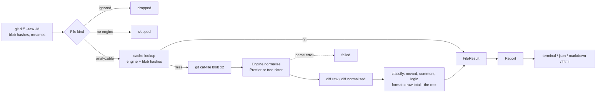

# Architecture

## Pipeline

| Module                       | Responsibility                                                              |
| ---------------------------- | --------------------------------------------------------------------------- |
| `src/git.ts`                 | Every git call. `execFile` with argument arrays; refs resolved to SHAs.     |
| `src/languages.ts`           | Which file gets which engine; ignored, generated and unsupported files.     |
| `src/engines/prettier.ts`    | Normalise by formatting with the project's Prettier config.                 |
| `src/engines/tree-sitter.ts` | Normalise by printing a syntax tree as canonical text.                      |
| `src/classify.ts`            | Counting and the logic / comment / moved / format split. Pure functions.    |
| `src/analyze.ts`             | Orchestration: concurrency, caching, aggregation. The only stateful module. |
| `src/cache.ts`               | Content-addressed result cache.                                             |
| `src/report/*`               | Renderers. Pure functions from `Report` to string.                          |
| `src/cli.ts`, `src/mcp.ts`   | Two front ends over the same `analyze()`.                                   |

## The metric

For each file, `total` is the number of lines added plus removed between the raw versions. The classifier works on the _normalised_ versions and produces `logic`, `comment` and `moved`. `format` is whatever is left of `total`.

Invariant, enforced by `buildBreakdown` and tested: `logic + comment + moved + format === total`, all non-negative. Because normalised and raw line counts are measured on different text, the signal part is clamped to `total` rather than trusted.

- **moved**: removed and added lines are matched as a multiset on the _exact line including indentation_. The same statement at another nesting level is not a move; it changes behaviour. Lines without a letter or digit (`}`) never match, otherwise any two blocks would "move" into each other.
- **comment**: the remaining lines that match the file's comment syntax.
- **format** also absorbs blank-line changes: whether a blank line exists is style.

## Decisions

**Prettier as a normaliser, not a linter.** Formatting both sides with the same options removes every formatting-only difference without maintaining a list of them. The project's config is used because normalising with other options than the author's would invent differences. `.prettierignore` is deliberately ignored: a file the project does not format still has to be compared fairly.

**Canonical text instead of an AST diff for other languages.** A structural tree diff is far more work and its output (edit scripts) does not map back to review lines. Printing the tree as one-statement-per-line text lets the same line diff, the same classifier and the same cache serve every language. Depth is part of each line, so nesting changes are visible; layout is not.

**Content-addressed cache.** The key is `sha256(schema, engine fingerprint, extension, old blob, new blob)`. The engine fingerprint includes the Prettier version and resolved options, or the grammar and canonicalisation version. A key can only match if the answer would be identical, so there is no TTL and no invalidation. Writes are atomic (temp file, then rename), and any cache failure degrades to a miss.

**No shell, ever.** Branch and file names are untrusted. All git calls use `execFile` with an argument array, user refs are resolved with `rev-parse --verify --end-of-options` and only the resulting SHA is passed on. Tests cover hostile branch and file names.

**`web-tree-sitter` is pinned to 0.25.x.** The prebuilt grammars in `tree-sitter-wasms` use an older wasm ABI that `web-tree-sitter` 0.26 and later cannot load. Dependabot is configured to leave it alone. Moving to newer grammars means replacing that package, not just bumping a version.

**A file that cannot be parsed is never signal.** Parse errors, binary content and unsupported languages are reported separately and excluded from the totals. Treating them as "changed" would inflate the ratio exactly when the tool knows least.

## Adding a language

1. Add the extension to `TREE_SITTER_GRAMMARS` in `src/languages.ts` (the grammar must exist in `tree-sitter-wasms/out`).
2. Add a case to `test/engines.test.ts`: a base program, the same program reformatted, and a changed program.
3. If nesting does not show up correctly, extend the `CONTAINER` pattern in `src/engines/tree-sitter.ts`.
4. Add a comment syntax to `commentPattern` if it is not `//`, `/* */` or `#`.
5. Bump the `canon` suffix of the fingerprint if canonicalisation changed, so old cache entries are not reused.
